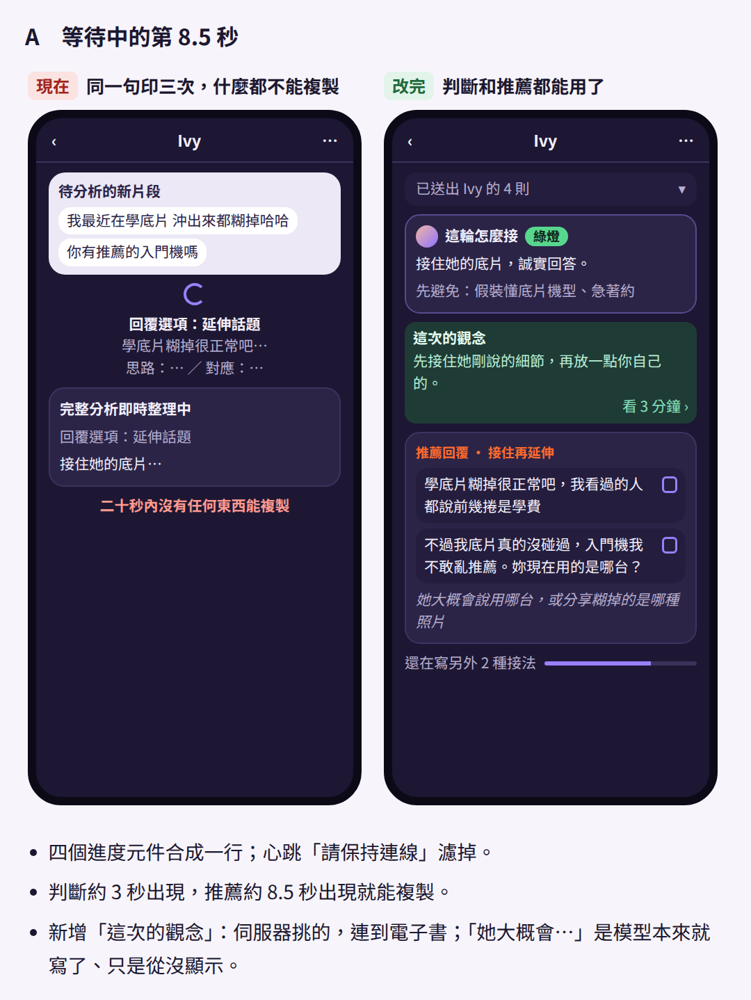
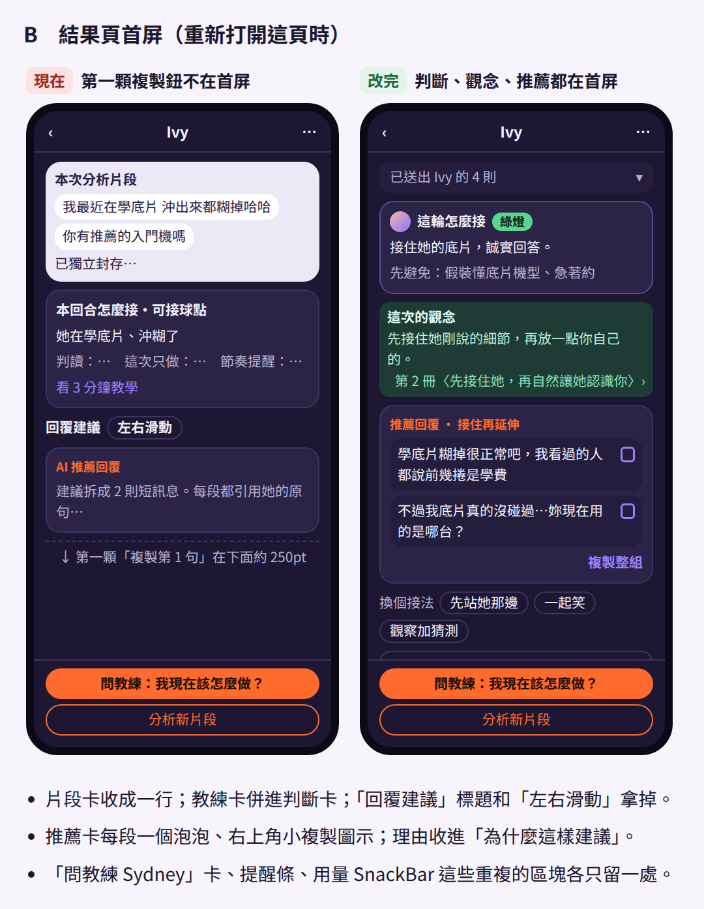
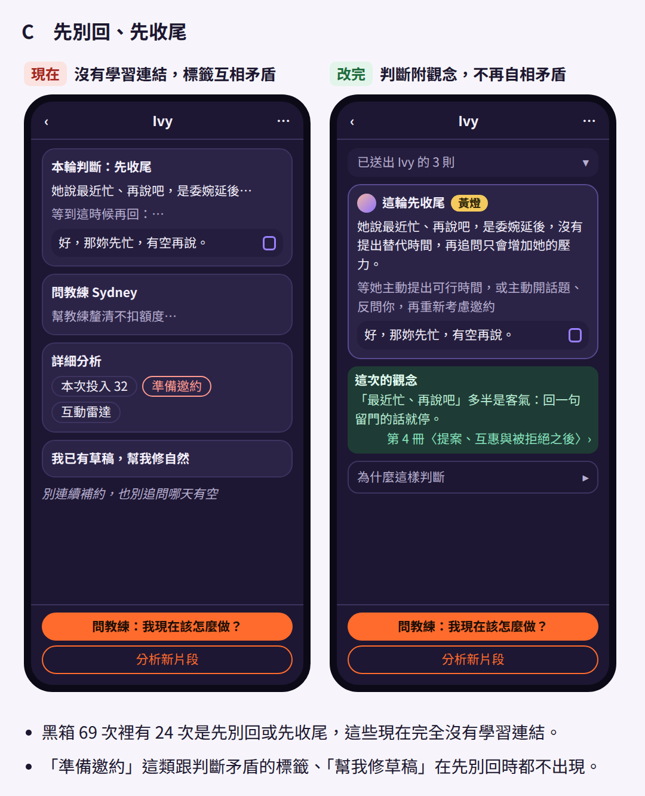
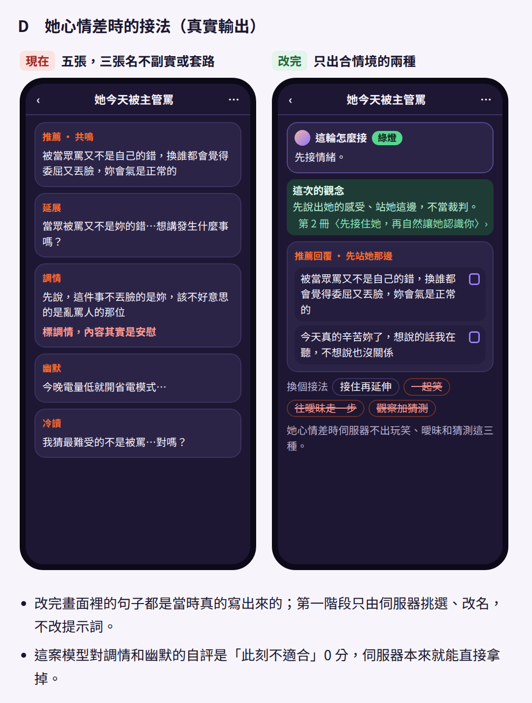
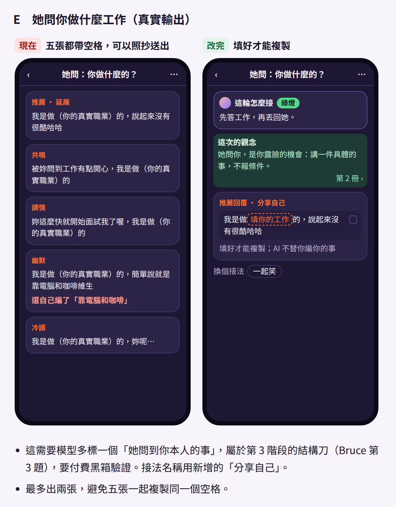
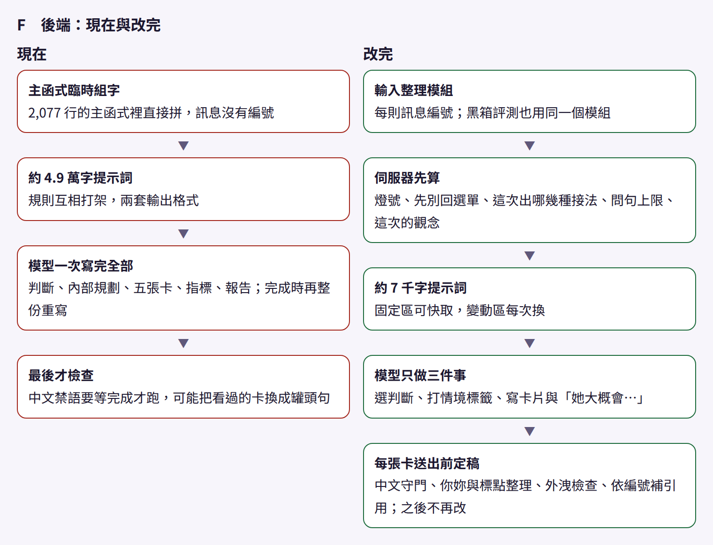

# 對話分析改版設計（2026-10-14 版：照 Bruce 的聊天魅力指南 v3.1；第 1 階段已上線）

> 給 Bruce：第一部分是白話，先看這段就好。第二部分是技術規格，可以交給你的 Claude Code 讀。
>
> 這一版取代 10/12、10/13 的兩版。10/13 晚我們提了五點（能算的交給程式、提示詞只帶需要的、範例另外測、多帶要有證據、先做安全網），你 10/14 回：第 1、3、5 點同意，第 2、4 點改用你自己寫的「聊天魅力指南 v3」。Eric 同意照 v3 走；我們原本提的「立場層」不加，v3 的 A1 就是立場。之後你在交叉比對題目單回的 24 題，已經套進 v3，存成 v3.1。
>
> 這個 repo 是公開的。這份文件只寫課程的章節編號和 v3 的段落編號（A1–A6、B01–B42、C1–C6、D1–D6），不引用課程原文。v3 全文在本 PR 你的留言（`issuecomment-6159139899`），我們照你回覆改的地方在 `issuecomment-6164872920`；v3.1 全文在 Claude 本機。

## 第一部分：白話版

### 方向

- 10/13 你說改版後「變好政治正確 有客服感」，Eric 定調「完全對齊這份 規格 語氣 不要自作主張亂改」。當晚 Eric 補充：課程那好幾萬字不是沒用，但「全部堆進規則怕會沒用」「沒有證據會變好」，要「100% 對齊才敢動刀」。
- 10/14 你用 v3 取代「每次帶一兩節課程原文」：每次只送你寫的 A（約 5 千字），局面需要時再挑 1–3 條情境做法（B），要不要回、要不要約、每張卡做什麼由程式照 C 決定，D 只拿來驗收。課程原文不進提示詞。
- 照課程做的例外只有兩條，是 Eric 定的：涉及未成年的內容不進 App；她明確拒絕之後還施壓的做法不做。約到私人空間照你的 B20，Eric 10/14 決定不另加例外。

### 說明書怎麼帶（v3.1）

- **分兩段**：
  1. 讀局面：送 A3、A4 和 42 條 B 的觸發欄，AI 只輸出標記（燈號、她這句在做什麼、邀約準備度、要不要他的事實、符合哪幾條 B 等）和給用戶看的一兩句局面判讀。
  2. 程式照 C 決定：回、先別回、收尾或停；有沒有推進、推進做什麼；排 3–5 張卡，每張的任務、「有他」做法、口吻、問句額度；挑最多 3 條 B。
  3. 寫句子：送 A1、A2、A3、A5、A6、挑到的 B 和每張卡的規格，AI 一張一張寫。
- **每次多長**：讀局面那段約 2,600 字，寫句子那段約 5,100 字（含安全規則和輸出格式），加上聊天紀錄。現在是 4.9 萬字。
- **範例不放進提示詞**：D 的句子只拿來測。

### 你的決定怎麼落地

你在交叉比對題目單回的 24 題全部照做（本 PR `issuecomment-6161674736`）。不照我們預設的那幾題：

- 具體邀約：AI 和電子書都照 v3，由他帶、直接給一個時間、把安排攬下來。電子書 5.5 另外改（見「接下來」）。
- 種子：有沒有具體東西都可以（v3 A5 改了）；電子書 5.4 維持要有具體東西。
- 照樣寫＋標示：維持 v3 原樣，她問他的事、他的立場也可以用；身分資料只能留空格。
- 她大笑收尾：照 C4，一張收，另外還是要一張帶張力。
- 約到私人空間：照 B20，不排除還沒見過面。
- 問句：每張卡最多 1 個，種子不加問號。
- 他先開口的 B08、B23、B35：分析留著，新話題也放一份。
- 卡片以外：結果頁只留局面判讀，拿掉「她大概會……」。
- 推拉改回「製造張力」；稱讚照 10/13（只回簡短自信的話，稱讚一次不算投入夠）；誰追誰兩種都留，A1 補「也可以讓她投入、讓她主動」；第一次見面多久、修復還是離開、關係誰定義，先問他的想法再判斷。
- 審核尺照 v3 調三碼（unsupported_fact、stage_overreach、boundary_conflict），回覆意願照 A4。

「明顯投入」這類詞，我們改寫成看得到的條件，在 `issuecomment-6164872920` 請你確認。

### 用戶會看到的改變

1. 依局面給 3–5 張卡，標籤是接住、共鳴、帶張力、推進、收。第一張照順序：她給了機會是推進，其餘是接住或共鳴。
2. 推薦卡一寫完就能複製，之後每張到了就能複製（現在要等全部寫完，約 19 秒；原型第一張卡約 4.3 秒）。這要先把安全檢查搬到每張卡送出前，所以跟第 3 階段一起做。
3. 她問他的身分資料（工作、年紀、身高、感情狀態、住哪）時留空格，填好才能複製；照樣寫＋標示的卡會提醒「有編的細節，請改成你的」。
4. 先別回只說「等她做什麼再回」，不附備用句；她婉拒或說了界線，一句中性收尾；她取消又沒給別的時間，輕鬆接受、提一次改天。
5. 預設口吻稱呼用「你」；照他口吻的卡跟他。

### 驗收

已經跑過的（10/14，付費前都問過 Eric）：

- **跟通用 AI 比**：同一個 Sonnet 5.5，只給「你是戀愛教練」和聊天紀錄，23 案各 3 次。
- **v3.1 原型**：照兩段式和 C 在測試工具裡做，不動產品，23 案各 3 次，每案三次的決定都一致；第一張卡 p50 4.3 秒、p95 5.4 秒（現在 8.2 秒、11.1 秒）；平均每次分析不到 1 美分（現在約 4.5 美分）。
- **審核尺打分**（你的十二碼照 v3 調過三碼，只審推薦那一句）：要重寫的比例，現在 11%、v3.1 17%、通用 AI 25%。同一案同一次直接比，現在 5 張、v3.1 7 張（各 44 張），差距在現在這版自己重跑的起伏範圍內（單輪 7%–20%）。

還要的：

- 你的 23 題三方盲選（本 PR `issuecomment-6164874860`）。這是主要的裁判；你的選擇也會拿來量審核尺跟你本人有多一致。
- 上線門檻：盲選偏好 v3.1；審核尺的差距不比現在差（超過起伏範圍才算）；明顯贏通用 AI，而且你認得出來；第一張卡不比現在慢；一般語料 0 次拒答；編了沒標 0 次；她問身分資料時 100% 留空格。

### 另一邊：開場救星與新話題

- 新話題已經換 Sonnet 5.5；開場救星維持 Sonnet 5，等新說明書再比。
- v3 的 B 只給分析用；A1、A2 要不要也給開場與新話題，對話分析驗收過了再問你。B08、B23、B35 照你說的在新話題也放一份，由另一個 session 接。

### 接下來

- 第 1 階段（安全網）已上線：刪掉會誤擋正常對話的閘門、測試進 CI 也在部署前跑、v2 提示詞上鎖、重播測試（`e9388b19`、`be9d68a1`）。
- 等你的盲選。過了就照第二部分第 11 節開工第 3 階段；第 2 階段的資料迴圈可以先做。
- 電子書 5.3（改成兩次）、5.5（由他帶、直接給時間）另開一包，改好給你校對。
- 每個階段一個乾淨分支，由沒寫程式的模型家族主審。推送、部署、開關和付費都先問 Eric。這張 PR 只有文件和圖，先不合併。

### 10/12 版的前後對照圖（大多作廢）

每張左邊是現在，右邊是 10/12 版的改法；推薦回覆的文字取自黑箱錄下的真實輸出。A 等待中的第 8.5 秒、E 她問你做什麼工作（留空格）仍適用；B、C、D、F 的右邊作廢，改照 v3.1。

## 第二部分：技術規格（給 Claude Code）

基準是 main `be9d68a1`（第 1 階段已上線）。行號會隨程式漂移，以符號名稱為準。

### 0. 決定紀錄

- **10/12，Eric「預設同意」**：第 3 項（分析其餘呼叫換 5.5）保留，共用模型程式已由 ADR #55 上線；第 1、2 項被後來的決定取代。
- **10/13，Eric**：對 Bruce「完全對齊這份 規格 語氣 不要自作主張亂改」；照課程做的例外只有未成年、她明確拒絕後施壓；本人資料空格提前；驗收用 Bruce 的最後一關審核加盲選。
- **10/13，Bruce**：三則決定（`issuecomment-6137487015` 與後續兩則）：大方向 1、2，12 個主題，紅線段，已讀不回照乙等。
- **10/13 晚，Eric（方向修正）**：「那好幾萬字的說明不是說沒用，全部堆進規則怕會沒用」「我們現在反而 prompt 變多，沒有證據會變好」「這一大刀的目的：1 換 5.5，2 重構＋結構刀處理聊天分析」「現在第一刀都還沒下，我需要完整 100% 對齊才敢動刀」。我們在本 PR 提五點（`issuecomment-6146277826`）。
- **10/14，Bruce**：五點回覆（`issuecomment-6159139899`）：1、3、5 同意（1 的細節照 C1–C4）；2、4 改照他的 v3，黑箱比現在、結構刀＋v3、結構刀＋整包課程。
- **10/14，Eric**：照 v3；立場層不加；先在測試工具做 v3 原型、跑黑箱（「好」）；第 1 階段開工並推送（「推」）；付費測試（「跑」）。
- **10/14，Bruce**：交叉比對題目單 24 題（`issuecomment-6161674736`），內容見第一部分；整合備忘不需要，審核尺與回覆意願照 v3 改。
- **10/14，Eric「都照預設」**：照 Bruce 的回覆改 v3（v3.1）與審核尺、重跑、把盲選貼給 Bruce；約到私人空間不另加例外；第 2 階段的逐張可複製併進第 3 階段；設計文件改成 v3.1 版、準備電子書改寫包。

### 1. 分工

- **對話分析側**負責 analyze-chat 的分析路徑（v2 串流、舊路徑、截圖辨識、我說、潤飾、微調、背景評審）與共用模型程式（ADR #55）。
- **開場救星與新話題側**只動自己的功能檔；v3 的 A1、A2 要不要沿用，對話分析驗收後再問 Bruce。B08、B23、B35 新話題也放一份。
- **ADR**：#54 開場與新話題，#55 共用模型程式，#56 電子書與教學契約；對話分析下一刀合併時取當時下一個空號。

### 2. 現況（main `be9d68a1`）

- 第 1 階段已上線：`checkInput` 刪除（F01）；Edge 契約測試清單 `tools/ci/edge-contract-tests.sh` 給 PR CI 與部署共用，analyze-chat 與 `_shared` 整個目錄跑，部署前先跑（F21）；v2 串流提示詞四種組合鎖長度與 SHA-256、最常見一組存全文快照（F19）；重播測試 `analyze_replay_test.ts`，23 案錄好的 5.5 原始輸出餵回串流處理（F47）。Edge analyze-chat v432。
- 提示詞：v2 實際送出約 48,842 字元（sha256 `e48de35b…`），靜態底座 34,496 字元（`reasoning_core`、`conversation_policy`、`reply_voice`、`report_contract`、`examples_legacy`、安全規則、外洩指令），加串流契約與情境知識。
- 呼叫：一次串流，依序吐盤點、判斷（扣費點）、發散計畫、推薦、五張卡、報告；伺服器在 done 時才做中文禁語檢查與後處理，結果整份取代串流卡；App 要等 done 才畫回覆區、才能複製。
- 背景評審：Bruce 的十二碼（PR #98），只記錄不擋卡。
- 黑箱工具（本機分支 `claude/blackbox-generic-arm`，還沒推送）：通用 AI 對照臂（`run_generic.ts`）、v3 原型（`v3_proto.ts`、`run_v3.ts`）、三方比較與照 v3 調過的審核尺（`run_compare.ts`、`critic_v3.ts`）。v3 文字不進 repo，執行時用 `--guide` 指定本機檔。

### 3. 模型

- 兩段都用 Sonnet 5.5（production helper：adaptive thinking、display omitted、effort low）。讀局面那段要不要改用更小的模型，第 3 階段用黑箱比命中率與等待時間再定。
- 其餘照 10/12 版：截圖辨識改走 `modelRequestParams()`；我說、潤飾、微調換常數；舊版 App 路徑設最低版本後退休；背景評審固定 Sonnet 5。

### 4. 新說明書（v3.1）

**4.1 來源與改動**

- v3：本 PR `issuecomment-6159139899`（A 送進模型、B 情境條目、C 程式規則、D 測試答案）。
- v3.1：照 Bruce 10/14 的回覆改的地方列在 `issuecomment-6164872920`：A1 補「也可以讓她投入、讓她主動」；A1 表格「秒回連發」改「連發」；A4「一路變短變淡是在降溫」；A5 推拉「製造張力」、種子「有沒有具體的東西都可以」、曖昧的條件改成「投入夠」；B04 拿掉收下再撩；B20 觸發改「已經在曖昧層」；新增 B42（要聯絡方式）。
- 「明顯 X」改成的條件（待 Bruce 確認）：投入夠＝最近幾輪至少兩種（給的比他問的多、反問他、跟他解釋自己、主動開話題、主動虧他、撒嬌）；她在調情＝她最近幾輪自己撒嬌、半開玩笑提到兩人，或接了他的曖昧梗；在曖昧層＝投入夠或已經見過面。
- 字數：A 共約 5,000 字。讀局面的 system 約 2,600 字，寫句子的 system 約 5,100 字（含安全規則、外洩指令、輸出格式）。

**4.2 讀局面（第一段）**

- 帶 A3、A4，加 42 條 B 的觸發欄（不帶寫法欄）；結構化輸出（json_schema）。
- 標記：燈號；她這句在做什麼（A4 十一類）；她情緒差、喝醉或深夜情緒化；邀約準備度（A4 六種＋猶豫）；她取消時有沒有給別的時間；她這輪婉拒或說界線；明確拒絕（客氣但意思明確也算；先當朋友、不想談感情、只是說有男友都不算）；封鎖；風險；她在退；需不需要他的事實；她問的是不是身分資料；他說過的自己的事（逐字）；有沒有他的口吻樣本；回覆意願（只看延伸、反問、補內容）；值得接的球數；她最近幾輪每輪是不是只回敷衍的字；符合的 B 編號；給用戶看的局面判讀；要先別回時等她做什麼。
- 回覆快慢、隔了幾天、約過幾次不讓 AI 推算（A3），由程式依紀錄提供（第 7 節資料迴圈）。

**4.3 程式規則（C1–C4，含 Bruce 10/14 的選擇與我們的預設）**

- **C1 要不要回**：他的訊息是最後一則→先別回；明確拒絕或封鎖→停；他連續主動兩次、她都只回敷衍的字→先別回，只給「等她做什麼再回」，不附備用句；她只冷一次→照常回；她取消約會→有別的時間就接受，沒有就輕鬆接受、提一次改天；她婉拒或說了界線→一句中性收尾。
- **C2 天數與次數**：等資料迴圈接上才啟用（已讀不回 3 天後最多輕鬆重開一次；委婉拒絕後互動仍雙向，一週後換提案再約一次，第二次不行就停；兩次提案被帶過就不約；取消兩次就停）。啟用前，這段對話裡看得到她婉拒、取消或帶過提案時，不出推進卡、照常聊。
- **C3 推進**：她答應了→說定；她自己提見面、含糊答應或開窗→具體邀約（由他帶、給一個時間、把安排攬下來）；她取消又沒給時間→改天；聊開兩三輪、綠燈→種子（有沒有具體東西都可以、不給時間、不加問號）；她情緒差、喝醉或深夜、在退、有風險、紅燈→不出推進；婉拒過、猶豫照 C2；她拒絕給聯絡方式後，不出要聯絡方式的卡，也不改要別的（B42）。
- **C4 排卡**：她情緒差、黃燈、紅燈、她問他的事但缺他的資料→3 張；一般綠燈→4 張；綠燈而且她給了機會或丟了好幾顆值得接的球→5 張。情緒差全部共鳴；紅燈只用接住和收；她大笑收尾→一張收、一張帶張力、其餘接住；有推進動作至少一張推進（具體邀約時五張裡兩張）；綠燈至少一張帶張力。每張卡最多 1 個問句，種子不問。「有他」：身分資料只能留空格（他說過的可以用）；缺他的事實時至少一張留空格；照樣寫＋標示最多一張，接住或帶張力都可以，她情緒差和推進不用；有他說過的素材時優先用。口吻：有他的訊息時照他、預設交錯（第一張照他），沒有就全部預設。同規格的卡要換切入點。第一張照順序（推進在前，否則接住或共鳴）。
- **條目**：只從啟用的挑，最多三條；先挑停、拒絕、安全有關的（B11、B10、B36、B12、B32、B33），再挑她直接問的（B02、B19、B24–B30），最後其他；都不符合就不帶。

**4.4 寫句子（第二段）**

- 帶 A1、A2、A3、A5、A6、正式版的安全規則與外洩指令、挑到的 B（觸發＋寫法）、每張卡的規格（任務、「有他」做法、口吻、問句額度、切入點）。留空格的卡規格註明「他的事一律用＿＿，空格以外不寫他的事」（A2 第 3 點）。
- 輸出一行一張卡（JSONL）：卡號、1–3 則訊息、有沒有編的細節。不輸出「她大概會……」。輸出格式只有佔位符，沒有可以照抄的中文句子。
- 預設口吻的卡由程式把「妳」換成「你」（原型第一輪 41/108 張用了「妳」）；照他的卡不動。

**4.5 送出前的檢查與記錄（C5）**

- 先只記錄、不擋卡（Bruce 10/14）：問句數、「你呢？」結尾、預設口吻出現「妳」、表情數、跟她上一則的長度比、跟提示詞或 D 有 8 字以上相同（照抄）。黑箱看完比例再決定哪幾項改成擋卡。
- 要擋的：中文禁語與外洩（現在在 done 才做，第 3 階段搬到每張卡送出前，第 7 節）；「＿＿」沒填不能複製（App）。
- 「提示詞」只算我們寫的部分（輸出格式、A、B），不算聊天紀錄。

**4.6 v3 文字放哪裡**

- v3 是 Bruce 自己寫的，沒有課程原文（12 字比對 0 筆），全文已在本 PR 公開。預設跟現在的提示詞一樣放進 repo，用 sha256 鎖。課程原文不進提示詞，10/13 的「課程放 Supabase 私有儲存」在正式環境用不到，只有黑箱的整包課程臂要用，在本機讀。兩件都待 Eric 確認（第 12 節）。

**4.7 審核尺**

- 照 v3 調三碼（`critic_v3.ts`，目前只在測試工具）：unsupported_fact 認得「有編的細節」標示與「＿＿」空格（身分資料仍只能空格）；stage_overreach 照 C3（種子不用等綠燈、她回得短但一直有來有往的小提案不算越級；稱讚一次不算投入夠）；boundary_conflict 不把取消後提一次改天當再約。
- 回覆意願（`reply_voice.ts:8`）在新說明書裡由 A4 取代。
- 正式環境的背景審核在第 3 階段一起改。

**4.8 開關**

- 新說明書用新開關（暫名 `ANALYZE_GUIDE_V3`），預設關；現行提示詞原封不動，開關關回就是現在的樣子。

### 5. 卡片與首屏

- 3–5 張任務卡，標籤直接給用戶看：接住、共鳴、帶張力、推進、收。冷讀退場。
- 本人資料空格：填好才能複製；照樣寫＋標示的卡顯示「有編的細節，請改成你的」。
- 要 Eric 定（第 3 階段開工前）：付費文案「五種風格」改成「3–5 張，依情況搭配」；免費方案看幾張（ADR #25 現在固定給延展、調情，跟依局面排任務衝突）；資料庫扣費規則只收五種風格名（`analysis_stream_runs.selected_style`），要決定推薦卡怎麼對應，或做 migration（不用 `supabase db push`，照 targeted migration 流程）。

### 6. 觀念小卡

- 改用 v3 的詞寫（例如四個底氣、軟硬同在），白話為主、術語放括號；這些詞是 Bruce 自己的，請他確認來源後就不用等課程作者授權。小卡文字另給 Bruce 確認，做在開關後面。

### 7. 後端結構

- **兩段式**：讀局面→程式（C1–C4、挑 B）→寫句子。現在的串流契約（盤點、發散計畫、五風格）只留在舊路徑。
- **送出前逐張定稿、逐張可複製**（原本第 2 階段，併進來）：每張卡送出前做完禁語與外洩檢查、清洗、格式整理、空格與標示；送出後伺服器不再改字（不整組換安全句、不砍段、不重選），模型自己的 done 不能覆蓋卡片。已送出的卡存進 run，斷線重試只補缺的卡，不整組重生。App 一收到卡就畫成可複製的卡，done 時沿用；成效紀錄的 key 改用伺服器的 runId。付費少一張卡時前面已複製的卡算不算交付，開工前定。
- **資料迴圈**：
  - 已經有的：分析頁每次複製都記結果事件，複製後可回報照送、改了再送、沒送與她的反應，盡力上傳 `outcome_events`。
  - 要做：這個對象最近的結果摘要送進分析；每次分析的局面標記連同日期存在這個對象的本機紀錄，下次一起送，C2 才算得出跨次的次數與天數（只存標記，不存對話原文）；「我還是想回」記成不帶內容的事件；先唯讀查正式資料庫的量（要 Eric 核准）。
  - 他在她最後一則之後傳的訊息要不要送進分析（健檢 F04；C1 第一條、已讀不回都要靠它）：Bruce 10/3 答「送」，計費細節待 Eric。
- **先問他的想法**：第一次見面多久、修復還是離開、關係誰定義這類，分析先問用戶的想法再判斷（Bruce 10/14），第 3 階段設計時給 Bruce 看。

### 8. 截圖辨識與輸入流程

照 10/12 版：品質維持；固定規則移到能吃快取的位置；選圖後一顆「確認並分析」；截圖辨識的改動維持隔離。第 4 階段做。

### 9. 安全網（第 1 階段，已上線）

- `e9388b19`：刪 `checkInput`（F01）、測試清單共用與部署前測試（F21）、v2 提示詞上鎖（F19）。Codex 主審 APPROVED。
- `be9d68a1`：重播測試（F47），10/14 用正式設定錄 23 案。Codex 主審兩輪後 APPROVED。
- 主審紀錄：`docs/reviews/2026-10-14-analysis-stage1-safety-net-review-record.md`、`docs/reviews/2026-10-14-analysis-stage1-replay-review-record.md`。

### 10. 驗收

- **黑箱**：23 案各 3 次。比的臂：現在（10/3 基準，提示詞雜湊與設定 10/14 核對沒變）、v3.1、通用 AI；整包課程臂（結構刀＋課程原文分層、不帶 A 和 B）在第 3 階段補，要明顯好過 v3.1 才採用。
- **打分**：照 v3 調過的審核尺，三份同一把、只給對話、審推薦那一句。D5 的 69 案標準答案要先照「只冷一次照回」等新規則更新；7/45 基準是舊審核尺量的，要用新尺重量。
- **10/14 已有的數字**：要重寫 現在 5/44、v3.1 8/48、通用 AI 17/69；第一張卡 v3.1 p50 4.3 秒、p95 5.4 秒（現在 8.2 秒、11.1 秒）；v3.1 每案平均 US$0.0076（現在約 US$0.045）。v3.1 每案三次的決定一致。
- **盲選**：Bruce 23 題三方（`issuecomment-6164874860`），之後 Eric。用他的選擇量審核尺跟他本人的一致率（開場那把是 0.71）。
- **門檻**：盲選偏好 v3.1；審核尺不比現在差（差距超過起伏才算）；明顯贏通用 AI 而且 Bruce 認得出來；第一張卡不比現在慢；一般語料 0 次拒答；編了沒標 0 次；身分資料 100% 留空格；B 條目有被照做。
- **費用**：v3.1 一輪 69 次約 US$0.5，三方評審約 US$0.7。每次付費先問 Eric。

### 11. 施工順序

| 階段 | 做什麼 | 用戶看到 | 付費（每次先問 Eric） |
|---|---|---|---|
| 1 安全網（已上線） | 刪誤擋閘門、測試進 CI 與部署前、提示詞上鎖、重播測試 | 正常對話不再被擋 | 錄重播 US$1.63（已跑） |
| 2 資料迴圈 | 結果摘要送進分析、「我還是想回」事件、唯讀查量；F04 定案 | 教練記得前幾次發生的事 | 可能一次小額確認 |
| 3 v3.1 上線 | 兩段式、C 規則、任務卡與標籤、送出前逐張定稿與逐張可複製、跨次局面紀錄、審核尺改版、扣費對應或 migration、付費頁文案；黑箱與盲選 | 3–5 張卡、第一張約 4 秒能複製、語氣照 v3 | 黑箱一輪約 US$1.2 |
| 4 其餘呼叫換 5.5、截圖辨識 | 截圖辨識、我說與潤飾換 5.5；確認流程 | 少等、少點 | 黃金集兩臂約 US$8 |
| 5 開場與新話題沿用 | A1、A2 是否沿用由 Bruce 定；B08、B23、B35 進新話題 | 語氣一致 | 那邊另外問 |
| 6 清理 | 舊版 App 路徑設最低版本後退休 | 沒有變化 | 無 |

電子書 5.3、5.5 的改寫另開一包，跟上面平行，Bruce 校對、Eric 核准。

### 12. 之後再定（Eric）

- v3 文字放進 repo（預設），以及撤回 10/13 的「課程放 Supabase 私有儲存」。
- 付費文案與免費方案張數（ADR #25）；扣費對應或 migration。
- 他在她最後一則之後傳的訊息送進分析的計費（F04）。
- 教練共用的知識庫：私人空間那條「再用一句低壓確認」要不要拿掉（Coach 也在用）。
- 對話裡出現自傷訊號時怎麼處理（v3 沒寫）。
- 課程原句能不能顯示給用戶（課程作者授權）。

### 13. 依據與還沒核實

- **依據**：main `be9d68a1`；10/3 健檢與黑箱基準；10/14 黑箱（通用 AI、v3 原型兩輪、v3.1、三方評審）；Bruce 10/13、10/14 的留言；Eric 10/13、10/14 的決定；10/14 的唯讀交叉比對（設計文件、Bruce 決定、電子書契約、現行程式、課程包）。
- **還沒核實**：Bruce 的盲選；審核尺跟 Bruce 本人的一致率；兩段式在正式環境的第一張卡時間；讀局面標記的命中率；整包課程臂；正式資料庫裡結果事件的量；免費方案沒有黑箱。
- 這份設計由 Claude 與子代理完成；實作時每個階段照流程送另一家模型主審。
